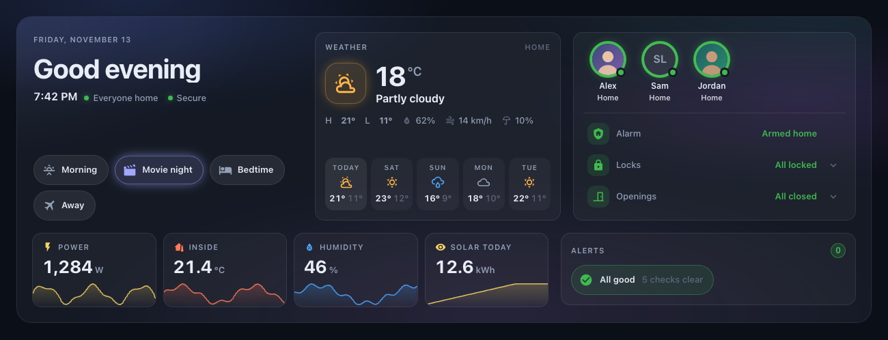

# Glasshouse Hero Card

The "state of the house" panel for the top of a Home Assistant dashboard. One glance answers:
what time is it and which mode is on, who's home, is the house secure, what's the weather,
and is anything wrong.

Part of the **Glasshouse** suite: refined dark glass, dense live data, one design system.



## Features

- **Greeting + live clock**: "Good morning / afternoon / evening" or "Late night" by time of day
  (or your own `title`), full date, and a clock that updates every 30 s. Honours your HA profile's
  language, 12/24-hour setting and server/local time zone.
- **At-a-glance summary** next to the clock: who's home, security state, alert count.
- **Mode chips**: tap toggles an `input_boolean` (or switch/light/fan), runs a `script`,
  activates a `scene`, presses a `button`. Active modes glow in the accent colour. Hold opens more-info.
- **Weather**: condition icon, temperature, condition text, today's high/low, humidity, wind,
  rain chance and a 5-day strip. Uses the `forecast` attribute when present, otherwise subscribes
  to the modern `weather/subscribe_forecast` API automatically.
- **People**: avatars (`entity_picture`, or initials) with a home / away / zone ring.
- **Security row**: alarm state (disarmed neutral, armed green, arming amber, triggered red with
  pulse), locks ("All locked" / "Back door unlocked") and openings ("All closed" /
  "2 open: Garage, Back door"). Openings turn red if the alarm is armed. Tap opens the first
  problem entity; hold (or the chevron) expands the full list.
- **Alerts**: rules per entity (`state`, `state_not`, `above`, `below`) with severity
  `alert | warn | info`; active ones become pills with a count badge, otherwise a calm "All good" chip.
- **Stats**: 2–4 big numbers with a 24 h sparkline from recorder history (optional).
- **Responsive**: three columns on desktop, two on tablets, stacked on phones (≤ 500 px card width,
  via `ResizeObserver`). Full-width in the sections view.
- Subtle animated aurora background (pure CSS, off with `prefers-reduced-motion`), which warms
  when an alert is firing.
- Keyboard and screen-reader friendly: real `<button>`s, `aria-pressed`, `aria-expanded`,
  visible focus ring.

## Installation

### HACS (custom repository)

1. HACS → three-dot menu → **Custom repositories**.
2. Add this repository's URL, category **Dashboard**.
3. Install **Glasshouse Hero Card** and reload the browser.

### Manual

1. Copy `glasshouse-hero-card.js` to `config/www/`.
2. Settings → Dashboards → three-dot menu → **Resources** → add
   `/local/glasshouse-hero-card.js` as a **JavaScript module**.

## Configuration

Every key is optional except `type`. Nothing is hard-coded: entities, names and icons all come
from your config.

| Option | Type | Description |
|---|---|---|
| `title` | string | Replaces the time-of-day greeting. |
| `weather` | entity | A `weather.*` entity. |
| `people` | list | `person.*` / `device_tracker.*` ids, or `{entity, name}` objects. |
| `modes` | list | Mode chips (see below). |
| `security` | map | `alarm`, `locks`, `openings` (see below). |
| `alerts` | list | Alert rules (see below). |
| `stats` | list | Up to 6 numbers (2–4 look best; see below). |
| `stats_style` | `tiles` / `compact` | `tiles` = sparkline tiles; `compact` = one slim row of labelled meters with a thin bar (value ÷ `max`, default 100), coloured by `thresholds` (`[{above, color}]`). |

### `modes[]`

| Option | Default | Description |
|---|---|---|
| `entity` | required | `input_boolean`, `script`, `scene`, `switch`, `light`, `fan`, `button`, `input_button`, … |
| `name` | friendly name | Chip label. |
| `icon` | entity icon | Any `mdi:` icon. |
| `color` | `var(--gh-accent)` | Active glow colour (any CSS colour). |

Tap: `homeassistant.toggle` (input_boolean and other toggles), `script.turn_on`,
`scene.turn_on`, `button.press` / `input_button.press`. Hold: more-info.

### `security`

| Option | Description |
|---|---|
| `alarm` | An `alarm_control_panel.*` entity. |
| `locks` | List of `lock.*` entities. |
| `openings` | List of door/window `binary_sensor.*` and/or `cover.*` entities. |

### `alerts[]`

| Option | Default | Description |
|---|---|---|
| `entity` | required | Any entity. |
| `state` | – | Active when the state equals this (string or list). |
| `state_not` | – | Active when the state is *not* this (string or list). |
| `above` / `below` | – | Active when numeric state is above / below (both = between). |
| `name` | friendly name | Pill label. |
| `severity` | `alert` | `alert` (red, pulses), `warn` (amber) or `info` (blue). |
| `icon` | by severity | Pill icon. |

With no condition, an alert is active when the state is `on`, `open`, `problem`, `unlocked`
or `triggered`. Unavailable entities never raise an alert.

### `stats[]`

| Option | Default | Description |
|---|---|---|
| `entity` | required | Usually a numeric sensor. |
| `name` | friendly name | Label. |
| `icon` | entity icon | Label icon. |
| `color` | by device class | Accent for icon and sparkline. |
| `decimals` | display precision | Override number of decimals. |
| `graph` | `true` | Show a sparkline from recorder history. |
| `hours_to_show` | `24` | Sparkline window. |

## Examples

### Full

```yaml
type: custom:glasshouse-hero-card
weather: weather.home
people:
  - person.alex
  - person.sam
modes:
  - entity: input_boolean.morning
    name: Morning
    icon: mdi:weather-sunset-up
  - entity: input_boolean.time_for_bed
    name: Bedtime
    icon: mdi:bed
  - entity: scene.away
    name: Away
    icon: mdi:airplane
security:
  alarm: alarm_control_panel.house
  locks: [lock.front_door, lock.back_door]
  openings: [binary_sensor.back_door, cover.garage]
alerts:
  - entity: binary_sensor.leak_kitchen
    state: "on"
    name: Kitchen leak
    severity: alert
  - entity: sensor.freezer_temperature
    above: -12
    name: Freezer warming
    severity: warn
  - entity: sensor.hall_sensor_battery
    below: 15
    name: Hall sensor battery
    severity: info
stats:
  - entity: sensor.power
    name: Power
    icon: mdi:flash
  - entity: sensor.indoor_temp
    name: Inside
  - entity: sensor.indoor_humidity
    name: Humidity
```

### Minimal

```yaml
type: custom:glasshouse-hero-card
weather: weather.home
title: Welcome home
```

## Theming

All Glasshouse tokens can be overridden from a theme with `--glasshouse-*` variables, e.g.
`--glasshouse-accent`, `--glasshouse-surface`, `--glasshouse-radius`, `--glasshouse-font`.

## Development

`test/harness.html` renders the card against a mock `hass` (desktop, tablet, phone; all-good
and alerts-firing) with stubbed `ha-card` / `ha-icon` / `ha-state-icon`. Open it in a browser
from the repo root. Query options: `?v=desktop,phone` (variants), `?t=07:15` (clock),
`?act=1` (interaction smoke test), `?clean=1` (hide labels/log).

## License

MIT © Peter Gray
